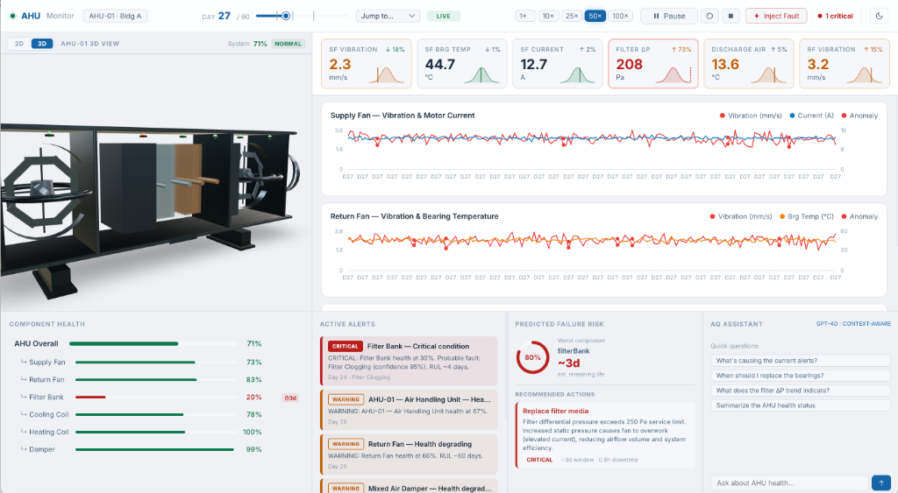
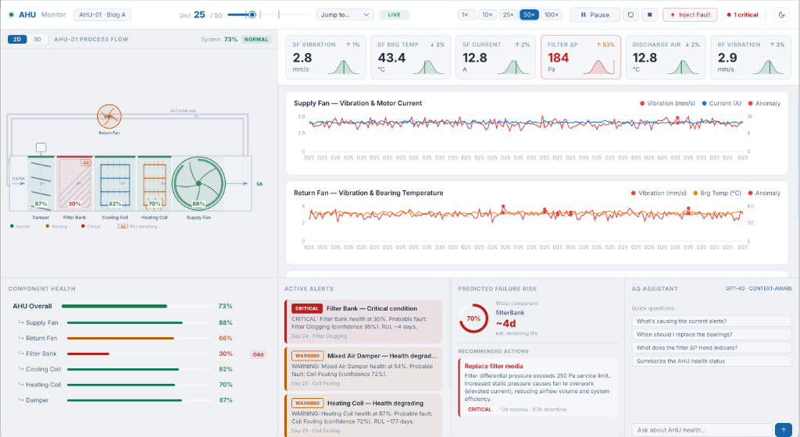

# AHU Predictive Maintenance Digital Twin

> A full-stack predictive maintenance digital twin for Air Handling Units (AHU): physics-based degradation simulation, multi-signal anomaly detection, fault diagnosis, and Remaining Useful Life (RUL) estimation with a real-time dashboard.

### 3D Spatial Digital Twin
*Interactive Three.js open-frame AHU model with component-level health coloring and live telemetry:*


### 2D P&ID Process Flow Schematic
*Real-time process flow diagram with component health status, sensor gauges, and RUL badges:*


---

## 🌐 Live Deployments

- **Live Dashboard**: [https://ahu-monitor.vercel.app](https://ahu-monitor.vercel.app)
- **FastAPI Swagger Docs**: [https://ahu-monitor.onrender.com/docs](https://ahu-monitor.onrender.com/docs)
- **GitHub Repository**: [https://github.com/amit0101/ahu-monitor](https://github.com/amit0101/ahu-monitor)

---

## ✨ What This Demonstrates

| Dimension | Approach |
|-----------|----------|
| **Asset model** | Graph-based digital twin with Haystack-inspired tagging — mirrors how real BMS/CMMS models work |
| **Sensor data** | Physics-based degradation simulation with 5 realistic HVAC fault modes (not random noise) |
| **Anomaly detection** | Three-layer: EWMA residual + CUSUM change detection + Isolation Forest (multi-variate) |
| **Fault diagnosis** | Cosine-similarity signature matching across multi-signal deviation vectors |
| **Prediction** | Exponential + linear RUL curve fitting via `scipy.optimize.curve_fit` |
| **3D visualization** | React Three Fiber scene with health-coded component colors + animated fan |
| **Domain alignment** | ISO 10816 vibration severity bands, ASHRAE maintenance language, Haystack tags |

---

## 🚀 Quick Start — Docker (recommended)

```bash
# 1. Clone
git clone https://github.com/amit0101/ahu-monitor.git
cd ahu-monitor

# 2. (Optional) Set OpenAI key for the AI Assistant chat panel
export OPENAI_API_KEY=sk-...

# 3. One-command startup
docker compose up --build
```

Open **http://localhost:5173** — the dashboard loads with the AHU in normal state and the simulation running.

> The `--build` flag is only needed on first run. Subsequent starts use `docker compose up`.

---

## 🛠 Local Development (without Docker)

### Backend

```bash
cd backend
pip install -r requirements.txt        # Python 3.11+
uvicorn main:app --reload --port 8000
```

API docs available at http://localhost:8000/docs

### Frontend

```bash
cd frontend
npm install
npm run dev                            # Vite dev server with HMR
```

Dashboard at http://localhost:5173 (Vite proxies `/api` and `/ws` to port 8000).

---

## 🎬 Demo Walkthrough

The simulation runs an **accelerated 90-day scenario** at 50× speed (≈ 3 minutes real time):

| Sim Day | Event |
|---------|-------|
| 0–20 | Normal operation — all components green, baseline telemetry |
| **~20** | 🟡 Filter bank ΔP begins rising (FM-4: filter clogging) |
| **~25** | First alert: *"Filter Bank health degrading"* — ΔP chart crosses 250 Pa reference line |
| **~35** | 🟡 Return fan vibration begins exponential rise (FM-1: bearing wear) |
| **~42** | Bearing fault diagnosed: *"Probable cause: Bearing Wear (progressive)"* — RUL estimate appears |
| **~55** | 🔴 Coil fouling detected (FM-3) — concurrent fault test |
| **~65** | Return fan health critical — RUL < 20 days |
| **~70** | Maintenance recommendation: *"Replace fan bearings — Priority: CRITICAL"* |

### Interactive Controls

- **Speed slider & controls** — throttle from 1× to 100× in real time, or pause/resume
- **Milestone Jump** — jump directly to key timeline milestones (Day 25 filter alert, Day 40 bearing fault, Day 50 multi-fault)
- **Inject Fault** — manually trigger any of the 5 fault modes at the current sim day
- **2D / 3D Views** — switch between P&ID process flow schematic and interactive 3D scene
- **AI Assistant** — ask questions like *"What's wrong with the fan?"* (requires OpenAI key)

---

## 🏗 Architecture

```
ahu-monitor/
├── backend/               FastAPI application
│   ├── twin/              Digital twin graph (Haystack-inspired entities)
│   ├── simulator/         Physics-based degradation engine (50× speed)
│   ├── analytics/         Anomaly detection, diagnosis, RUL estimation
│   └── api/               REST endpoints + WebSocket streaming
│
└── frontend/              React 18 + TypeScript dashboard
    └── src/
        ├── three/         React Three Fiber 3D AHU scene
        ├── components/    Dashboard panels (P&ID schematic, charts, health, alerts, maintenance)
        ├── hooks/         WebSocket + REST polling hooks
        └── stores/        Zustand global state
```

Documentation:
- [`docs/BACKEND_EXPLAINED.md`](docs/BACKEND_EXPLAINED.md) — Layered engineering explainer: physics, detection, diagnosis, RUL, and alerting
- [`docs/ARCHITECTURE.md`](docs/ARCHITECTURE.md) — System architecture, design decisions, and POC-to-production roadmap
- [`docs/BACKEND_CHEATSHEET.md`](docs/BACKEND_CHEATSHEET.md) — Quick technical reference of formulas, constants, and decision rules

---

## 🧪 Tests & Evaluation

### Automated Unit Tests
```bash
cd backend
pytest -v                              # 31 tests (14 degradation + 17 analytics)
```

All tests run in < 3 seconds. No mocking of the simulation engine — tests exercise real degradation curves and real anomaly detectors.

### Headless Scenario Evaluation
```bash
cd backend
python3 evaluate.py
```
Runs the full 90-day simulation headlessly and evaluates the analytics against ground truth (lead time, detection rate, false alarms).

---

## ⚙️ Configuration

Key settings in `backend/.env` (copy from `.env.example`):

| Variable | Default | Description |
|----------|---------|-------------|
| `SIM_SPEED_MULTIPLIER` | `50` | Simulation acceleration (1–500×) |
| `SIM_AUTO_PLAY` | `true` | Start simulation on app boot, at `SIM_START_DAY` (default 25) |
| `OPENAI_API_KEY` | *(empty)* | For AI Assistant LLM chat |
| `OPENAI_MODEL` | `gpt-4o-mini` | LLM model selection |
| `EWMA_ALPHA` | `0.01` | EWMA smoothing factor (lower = slower to adapt) |
| `HEALTH_WARNING_THRESHOLD` | `0.70` | Health score → WARNING state |
| `HEALTH_CRITICAL_THRESHOLD` | `0.40` | Health score → CRITICAL state |

---

## 🔧 Tech Stack

| Layer | Technology | Why |
|-------|------------|-----|
| Backend | Python 3.11 + FastAPI | Async ASGI framework with high throughput |
| Analytics | NumPy, SciPy, scikit-learn | Curve fitting, statistical filters, and Isolation Forest |
| Real-time | WebSocket (FastAPI native) | Low-latency binary/JSON telemetry streaming |
| Frontend | React 18 + TypeScript + Vite | Strongly-typed modern component architecture |
| State | Zustand | Lightweight reactive state without boilerplate |
| Charts | Recharts | SVG-based responsive timeseries charting |
| 3D | React Three Fiber (Three.js) | WebGL spatial digital twin with component-level picking |
| Containers | Docker + docker-compose | Reproducible multi-service deployment |
