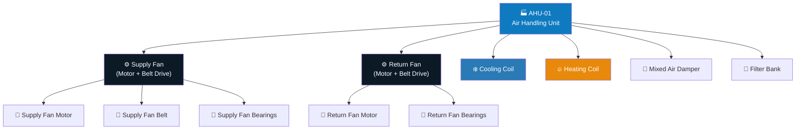
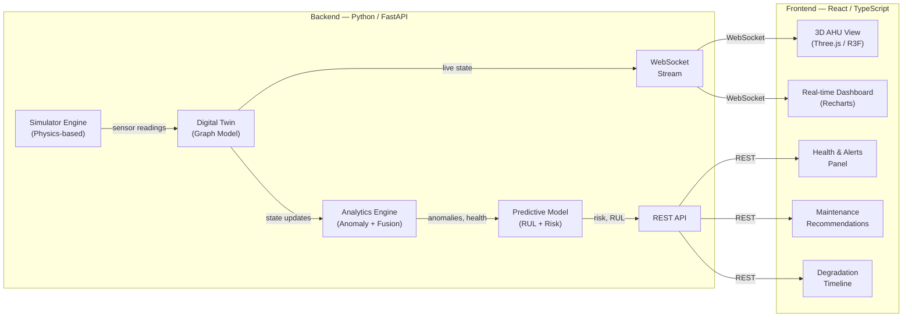
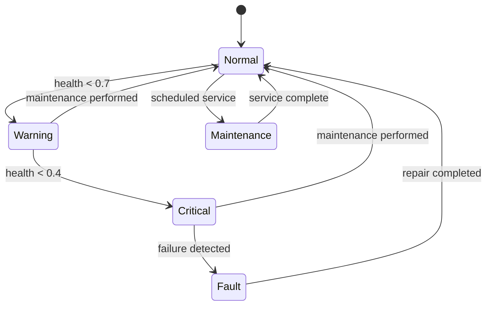
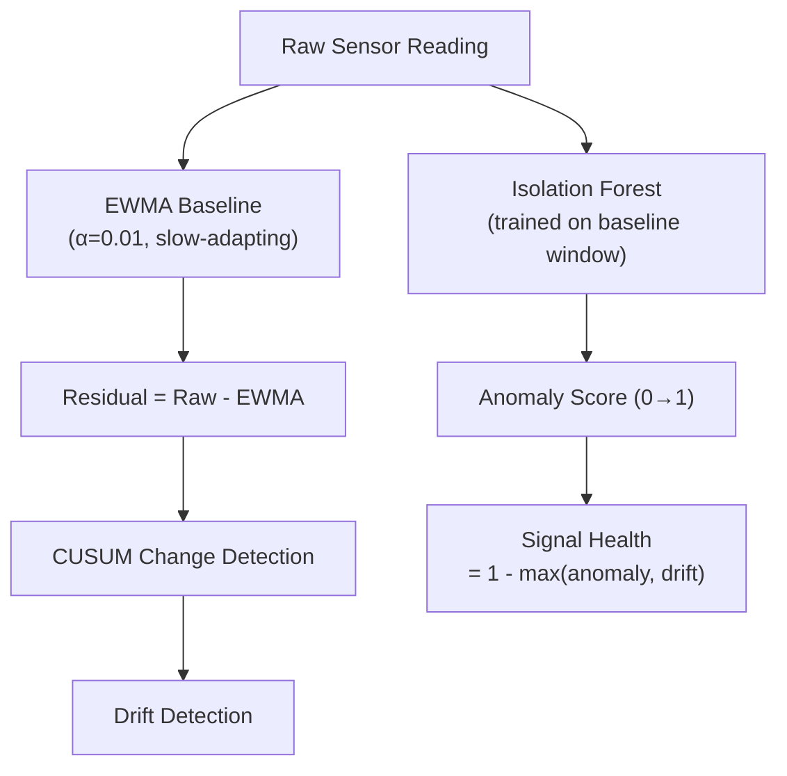

# 🏗️ Aqueduct Predictive Maintenance POC — Implementation Plan

> **Goal**: Build a showcase-quality POC that demonstrates deep understanding of Milvian's Aqueduct platform, HVAC domain expertise, and full-stack engineering maturity — not just a checkbox exercise.

---

## 1. Strategic Framing — Why This Plan Will Stand Out

The assessment asks for "credible predictive-maintenance approach and engineering thinking." Most candidates will build a basic dashboard with random noise and threshold alerts. Here's how we go further:

| Dimension | Typical Submission | Our Approach |
|---|---|---|
| Asset model | Flat JSON blob | **Graph-based digital twin** with parent→child component hierarchy, mirroring how real BMS models work |
| Sensor data | Random noise + thresholds | **Physics-based degradation simulation** with realistic fault signatures |
| Analytics | Single-signal z-score | **Multi-signal fusion** with Isolation Forest + EWMA + weighted health index |
| Prediction | "Health < 50% = bad" | **Remaining Useful Life (RUL)** curve fitting + failure probability timeline |
| Visualization | Basic line charts | **3D AHU model** (Three.js) + real-time WebSocket dashboard + glassmorphic UI |
| Domain alignment | Generic | **Haystack-tagged entities**, naming conventions matching Aqueduct's aQ Core product |

---

## 2. Asset Selection — Air Handling Unit (AHU)

An AHU is the ideal HVAC asset because it has multiple interacting sub-components, each with distinct failure modes and sensor modalities. This lets us demonstrate **multi-signal fusion** convincingly.

### Component Hierarchy (Digital Twin Graph)



### Sensor Map (Per Assignment Requirements)

| Sensor Type | Location | Unit | Sampling | Failure Signature |
|---|---|---|---|---|
| **Vibration** (accelerometer) | Fan bearings (x2) | mm/s RMS | 1 Hz (simulated) | Bearing wear → rising amplitude, spectral shift |
| **Acoustic** (SPL) | Fan housing | dBA | 1 Hz | Belt slippage → tonal peaks; bearing → broadband rise |
| **Temperature** | Bearing housing, discharge air, coil surface | °C | 1 Hz | Bearing failure → localized heating; coil fouling → poor ΔT |
| **Electrical** (current/power) | Fan motor supply | A / kW | 1 Hz | Filter clogging → rising current; belt slip → current dips |
| **Pressure** (differential) | Across filter bank | Pa | 1 Hz | Filter clogging → rising ΔP |

---

## 3. Architecture



### Tech Stack (Matching JD Exactly)

| Layer | Technology | Rationale |
|---|---|---|
| Backend | **Python 3.11 + FastAPI** | JD primary backend language |
| Data processing | **Pandas, NumPy, SciPy** | JD scientific Python stack |
| Anomaly detection | **scikit-learn (Isolation Forest)** | Production-grade ML |
| Time-series store | **SQLite + in-memory buffer** | Lightweight for POC; demonstrates time-series thinking |
| Real-time | **WebSocket (FastAPI)** | JD: WebSocket data feeds |
| Frontend | **React 18 + TypeScript** | JD primary frontend stack |
| State management | **Zustand** | JD mentions Redux/Zustand |
| 3D visualization | **React Three Fiber (Three.js)** | JD: Three.js digital twins |
| Charts | **Recharts** | Clean, composable React charting |
| Styling | **CSS Modules + CSS custom properties** | Clean, no heavy framework |
| Dev tooling | **Vite** | Fast builds |
| Containerization | **Docker + docker-compose** | JD: Docker, containerized deployments |

---

## 4. Digital Twin Design

### 4.1 Entity Model (Haystack-inspired)

Each entity in the twin carries semantic tags inspired by [Project Haystack](https://project-haystack.org/), which Milvian explicitly lists as a core technology:

```python
# Simplified entity schema
@dataclass
class TwinEntity:
    id: str                          # e.g., "ahu-01.supplyFan.motor"
    dis: str                         # Display name
    tags: set[str]                   # {"ahu", "equip", "fan", "supply", "motor"}
    parent_id: str | None            # Graph edge to parent
    points: list[SensorPoint]        # Attached sensor points
    state: OperatingState            # Running, Standby, Fault, Maintenance
    health: HealthScore              # 0.0 → 1.0 composite
    metadata: dict                   # Manufacturer, install date, rated specs
```

### 4.2 Operating State Machine



### 4.3 Health Score Composition

The top-level AHU health is a **weighted roll-up** from component health scores:

```
AHU_health = Σ(component_weight × component_health) / Σ(component_weight)

Where component_health = Σ(signal_weight × signal_health) / Σ(signal_weight)
```

Weights reflect operational criticality:
- Supply Fan: **0.35** (most critical)
- Cooling Coil: **0.20**
- Filter Bank: **0.15**
- Return Fan: **0.15**
- Heating Coil: **0.10**
- Damper: **0.05**

---

## 5. Physics-Based Simulation Engine

> [!IMPORTANT]
> This is a key differentiator. Instead of random noise, we simulate **realistic degradation physics** so the predictive model has credible data to work with.

### 5.1 Normal Operating Baseline

Each sensor has a defined baseline distribution based on real HVAC engineering data:

| Sensor | Baseline Mean | Std Dev | Physical Basis |
|---|---|---|---|
| Fan vibration | 2.8 mm/s | 0.3 | ISO 10816 good condition band |
| Fan acoustic | 72 dBA | 1.5 | Typical AHU ambient |
| Bearing temp | 45 °C | 2.0 | Normal running bearing |
| Discharge air temp | 13 °C (cooling) | 0.5 | Design setpoint |
| Motor current | 12.5 A | 0.4 | 75% rated load |
| Filter ΔP | 120 Pa | 8 | Clean filter baseline |

### 5.2 Degradation Models (5 Failure Modes)

Each failure mode follows a **degradation curve** with physics-based signal correlations:

#### FM-1: Fan Bearing Wear (Progressive)
```
degradation(t) = base × (1 + α × e^(β×t))

Affected signals:
  vibration  → +180% over 60 days (exponential rise)
  acoustic   → +40% (broadband noise increase)
  bearing_temp → +25°C (friction heating)
  current    → +8% (increased mechanical load)
```

#### FM-2: Belt Wear & Slippage (Progressive → Sudden)
```
degradation(t) = base × (1 + γ×t²)  # Quadratic acceleration

Affected signals:
  vibration  → +60% (misalignment harmonics)
  acoustic   → +25% (squealing tone)
  current    → -15% then +20% (slip then seize)
  speed      → -10% (reduced fan speed)
```

#### FM-3: Cooling Coil Fouling (Slow Progressive)
```
degradation(t) = base × (1 + δ×t)  # Linear buildup

Affected signals:
  discharge_temp → +4°C (poor heat transfer)
  coil_ΔT       → -30% (reduced effectiveness)
  power         → +15% (longer run time)
```

#### FM-4: Filter Clogging (Progressive)
```
degradation(t) = base + ε×t^1.5  # Sub-exponential ΔP rise

Affected signals:
  filter_ΔP  → +200% (250 Pa → 350+ Pa)
  current    → +12% (fan working harder)
  airflow    → -20% (reduced volume)
```

#### FM-5: Damper Actuator Failure (Intermittent → Stuck)
```
degradation: Random position drift → eventually stuck

Affected signals:
  mixed_air_temp → erratic (wrong mix ratio)
  discharge_temp → deviation from setpoint
  energy         → +25% (overcooling/overheating)
```

### 5.3 Simulation Timeline

The simulator runs an **accelerated 90-day scenario** where:
- Days 0–20: Normal operation (establish baseline)
- Days 20–40: FM-4 (filter clogging) begins, subtle
- Days 35–65: FM-1 (bearing degradation) begins, overlapping
- Days 55–75: FM-3 (coil fouling) emerges
- Days 70–90: FM-1 reaches critical, predictive alert triggers

This overlapping timeline tests the system's ability to **disentangle concurrent faults**.

---

## 6. Analytics Engine — Multi-Signal Fusion

### 6.1 Signal-Level Anomaly Detection



**Three-layer detection**:
1. **EWMA residual** — catches slow drift that thresholds miss
2. **Isolation Forest** — catches multivariate anomalies
3. **CUSUM** — detects persistent shifts (not just spikes)

### 6.2 Multi-Signal Fusion for Fault Diagnosis

Fault classification uses a **signature matching** approach:

```python
FAULT_SIGNATURES = {
    "bearing_wear": {
        "vibration": "high",      # > 2σ above baseline
        "acoustic": "elevated",   # > 1σ
        "bearing_temp": "high",   # > 2σ
        "current": "elevated",    # > 1σ
    },
    "belt_slippage": {
        "vibration": "elevated",
        "acoustic": "high",       # Distinctive squealing
        "current": "low_then_high",
        "fan_speed": "low",
    },
    "filter_clogging": {
        "filter_dp": "high",
        "current": "elevated",
        "vibration": "normal",    # Key differentiator
        "airflow": "low",
    },
    # ... etc
}
```

Each incoming multi-signal snapshot is compared against all signatures using a **cosine similarity** on normalized deviation vectors. The top-matching fault + confidence score is reported.

### 6.3 Remaining Useful Life (RUL) Estimation

```python
def estimate_rul(degradation_history: list[float], threshold: float) -> int:
    """
    Fit exponential degradation curve to history,
    extrapolate to find time-to-threshold crossing.

    Uses scipy.optimize.curve_fit with:
      model: y = a * exp(b * t) + c
    """
    # Fit to most recent 30% of data (recent trend matters most)
    # Project forward until health < threshold
    # Return days-to-failure with confidence interval
```

> [!TIP]
> The exponential fit is shown alongside a linear extrapolation on the dashboard, visually demonstrating why naive linear prediction underestimates risk for accelerating faults.

---

## 7. Backend API Design

### REST Endpoints

| Method | Path | Purpose |
|---|---|---|
| `GET` | `/api/twin` | Full digital twin state (graph structure) |
| `GET` | `/api/twin/{entity_id}` | Single entity + attached points |
| `GET` | `/api/twin/{entity_id}/history` | Time-series history for an entity's sensors |
| `GET` | `/api/health` | Current health scores (all components) |
| `GET` | `/api/alerts` | Active alerts with severity + fault diagnosis |
| `GET` | `/api/alerts/history` | Historical alerts timeline |
| `GET` | `/api/predictions` | RUL estimates + failure probability |
| `GET` | `/api/maintenance` | Recommended maintenance actions |
| `POST` | `/api/simulation/start` | Start/restart simulation |
| `POST` | `/api/simulation/speed` | Adjust simulation speed (1x–100x) |
| `POST` | `/api/simulation/inject-fault` | Manually inject a fault mode |
| `GET` | `/api/simulation/status` | Current simulation day + state |

### WebSocket

| Channel | Payload | Rate |
|---|---|---|
| `ws://host/ws/live` | All sensor readings + health scores | Every simulated tick |
| `ws://host/ws/alerts` | New alerts as they fire | Event-driven |

---

## 8. Frontend — Dashboard Design

### 8.1 Layout (4 Panels)

```
┌──────────────────────────────────────────────────────────────┐
│  Header: "Aqueduct PdM" | AHU-01 | Day 45/90 | ⏩ Speed     │
├────────────────────┬─────────────────────────────────────────┤
│                    │  Panel B: Real-time Sensor Gauges       │
│  Panel A:          │  ┌─────┐ ┌─────┐ ┌─────┐ ┌─────┐      │
│  3D AHU Model      │  │Vibr.│ │Temp │ │Curr │ │ΔP   │      │
│  (Three.js)        │  └─────┘ └─────┘ └─────┘ └─────┘      │
│                    ├─────────────────────────────────────────┤
│  - Color-coded     │  Panel C: Time-series Charts            │
│    by health       │  ┌─────────────────────────────────┐   │
│  - Click to        │  │  Multi-line: vibration, temp,   │   │
│    select          │  │  current over time with          │   │
│    component       │  │  anomaly bands highlighted       │   │
│                    │  └─────────────────────────────────┘   │
├────────────────────┼─────────────────────────────────────────┤
│  Panel D:          │  Panel E: Maintenance Recommendations   │
│  Health Scores     │  ┌─────────────────────────────────┐   │
│  & RUL Gauges      │  │  🔴 Bearing wear detected        │   │
│                    │  │  RUL: ~18 days                   │   │
│  ┌──────────┐      │  │  Action: Schedule bearing        │   │
│  │ AHU  78% │      │  │  replacement within 2 weeks      │   │
│  │ Fan  62% │      │  │  Priority: HIGH                  │   │
│  │ Coil 91% │      │  │  Estimated downtime: 4 hours     │   │
│  │ Fltr 45% │      │  └─────────────────────────────────┘   │
│  └──────────┘      │                                         │
└────────────────────┴─────────────────────────────────────────┘
```

### 8.2 Visual Design Principles

- **Dark theme** with Milvian's color palette: `#0C1A26` (dark navy), `#0F7AC0` (Milvian blue), `#E8890C` (warning amber), `#17A673` (healthy green)
- **Glassmorphic panels** with `backdrop-filter: blur(12px)` and subtle borders
- **Smooth animations**: health gauges animate on change, chart data streams in real-time
- **Color-coded 3D model**: components shift from green → amber → red as health degrades
- **Typography**: Inter font (Google Fonts), clean hierarchy

### 8.3 3D AHU Model (Three.js / React Three Fiber)

A simplified but recognizable AHU built from geometric primitives:
- **Box** = AHU housing (transparent/wireframe)
- **Cylinder** = Fan wheel (animated rotation, speed tracks RPM)
- **Flat planes** = Filter bank (color shifts with ΔP)
- **Coil geometry** = Serpentine pipes
- **Arrows** = Airflow direction indicators

Components are **clickable** — selecting one filters the dashboard to that component's sensors.

---

## 9. File Structure

```
aqueduct-assignment/
├── README.md                          # Setup instructions + demo walkthrough
├── docker-compose.yml                 # One-command startup
├── Dockerfile.backend
├── Dockerfile.frontend
│
├── backend/
│   ├── requirements.txt
│   ├── main.py                        # FastAPI app + WebSocket
│   ├── config.py                      # Simulation parameters
│   │
│   ├── twin/
│   │   ├── __init__.py
│   │   ├── model.py                   # TwinEntity, SensorPoint, HealthScore
│   │   ├── graph.py                   # Digital twin graph (parent/child)
│   │   └── factory.py                 # Build AHU-01 twin from config
│   │
│   ├── simulator/
│   │   ├── __init__.py
│   │   ├── engine.py                  # Main simulation loop
│   │   ├── baseline.py                # Normal operating profiles
│   │   ├── degradation.py             # Physics-based fault models
│   │   └── scenarios.py               # Pre-built degradation timelines
│   │
│   ├── analytics/
│   │   ├── __init__.py
│   │   ├── anomaly.py                 # EWMA, Isolation Forest, CUSUM
│   │   ├── fusion.py                  # Multi-signal health scoring
│   │   ├── diagnosis.py               # Fault signature matching
│   │   └── prediction.py              # RUL estimation + failure risk
│   │
│   ├── api/
│   │   ├── __init__.py
│   │   ├── routes.py                  # REST endpoints
│   │   └── websocket.py               # WebSocket handlers
│   │
│   └── tests/
│       ├── test_degradation.py
│       ├── test_anomaly.py
│       ├── test_diagnosis.py
│       └── test_prediction.py
│
├── frontend/
│   ├── package.json
│   ├── tsconfig.json
│   ├── vite.config.ts
│   ├── index.html
│   │
│   ├── src/
│   │   ├── main.tsx
│   │   ├── App.tsx
│   │   ├── index.css                  # Design system tokens
│   │   │
│   │   ├── stores/
│   │   │   └── useTwinStore.ts        # Zustand: twin state + WebSocket
│   │   │
│   │   ├── hooks/
│   │   │   ├── useWebSocket.ts        # WebSocket connection + reconnect
│   │   │   └── useTwinApi.ts          # REST API hooks
│   │   │
│   │   ├── components/
│   │   │   ├── Layout.tsx
│   │   │   ├── Header.tsx
│   │   │   ├── HealthGauge.tsx         # Animated circular gauge
│   │   │   ├── SensorCard.tsx          # Real-time sensor reading
│   │   │   ├── TimeSeriesChart.tsx     # Recharts multi-line
│   │   │   ├── AlertsPanel.tsx         # Active + historical alerts
│   │   │   ├── MaintenancePanel.tsx    # Recommendations + RUL
│   │   │   ├── DiagnosisPanel.tsx      # Fault identification
│   │   │   └── SimulationControls.tsx  # Speed, inject fault, reset
│   │   │
│   │   ├── three/
│   │   │   ├── AHUScene.tsx            # React Three Fiber scene
│   │   │   ├── AHUModel.tsx            # AHU geometry + materials
│   │   │   ├── FanWheel.tsx            # Animated fan
│   │   │   ├── FilterBank.tsx          # Color-coded filter
│   │   │   ├── CoolingCoil.tsx         # Coil geometry
│   │   │   └── HealthOverlay.tsx       # Color overlays on components
│   │   │
│   │   └── types/
│   │       └── index.ts                # TypeScript interfaces
│   │
│   └── public/
│       └── favicon.svg
│
└── docs/
    ├── ARCHITECTURE.md                 # System design explanation
    ├── DEGRADATION_MODELS.md           # Physics rationale for each fault
    └── DEMO_WALKTHROUGH.md             # Step-by-step demo script
```

---

## 10. Implementation Phases

### Phase 1: Backend Foundation (≈ 4–5 hours)
1. Project scaffolding (Docker, FastAPI skeleton, Vite+React scaffold)
2. Digital twin model (`twin/model.py`, `twin/graph.py`, `twin/factory.py`)
3. Simulation engine with baseline profiles (`simulator/`)
4. Physics-based degradation models for all 5 failure modes
5. REST API endpoints for twin state
6. Basic automated tests for degradation curves

### Phase 2: Analytics Engine (≈ 3–4 hours)
1. EWMA + Isolation Forest anomaly detection
2. CUSUM change detection
3. Multi-signal fusion + health scoring
4. Fault signature matching / diagnosis
5. RUL estimation with exponential curve fitting
6. WebSocket streaming of live data + alerts

### Phase 3: Frontend Dashboard (≈ 4–5 hours)
1. Design system (CSS custom properties, dark theme)
2. Layout shell + Header + Simulation controls
3. Real-time sensor cards with WebSocket integration
4. Time-series charts (Recharts) with anomaly band highlighting
5. Health gauge components (animated SVG arcs)
6. Alerts panel + Maintenance recommendations panel
7. Zustand store wiring

### Phase 4: 3D Visualization (≈ 2–3 hours)
1. React Three Fiber scene setup
2. AHU geometry (box housing, fan cylinder, coil, filter)
3. Component click-to-select interaction
4. Health-based color mapping (green → amber → red)
5. Fan rotation animation tied to RPM data

### Phase 5: Polish & Documentation (≈ 2–3 hours)
1. Docker compose one-command startup
2. README with setup instructions
3. Architecture documentation
4. Demo walkthrough script
5. Edge case handling + error states
6. Final visual polish (animations, transitions, responsiveness)

---

## 11. Key Differentiators to Emphasize

> [!IMPORTANT]
> These are the things that will separate this submission from a typical take-home:

### Engineering Thinking
- **Graph-based digital twin** — not a flat data model; demonstrates understanding of BIM/asset modeling
- **Haystack-inspired tagging** — shows awareness of Milvian's actual technology stack
- **Physics-based simulation** — signals degrade according to real bearing wear curves (ISO 10816), not random noise
- **Multi-signal fusion** — a single fault affects multiple sensors differently; the system untangles concurrent faults

### Production Awareness
- **Docker-compose one-command startup** — reviewer can run it in 30 seconds
- **WebSocket for real-time** — not polling; matches the JD's emphasis on real-time dashboards
- **Automated tests** — shows reliability mindset
- **Type safety** — full TypeScript on frontend, Pydantic models on backend

### Domain Knowledge
- **ISO 10816 vibration severity bands** — real industrial standard
- **Realistic AHU operating parameters** — temperatures, pressures, currents based on real equipment
- **ASHRAE-aligned fault descriptions** — professional maintenance language

### Visual Impact
- **3D digital twin** — directly addresses the JD's "3D building digital twins" requirement
- **Premium dark-theme dashboard** — matches Milvian's own sleek design language
- **Animated gauges + real-time streaming** — the demo will feel alive, not static

---

## 12. Risk Mitigation

| Risk | Mitigation |
|---|---|
| Three.js complexity eats too much time | Prepare fallback: 2D SVG schematic of AHU with color-coded components (still impressive, just not 3D) |
| Isolation Forest needs training data | Pre-generate 20 days of baseline data during simulation startup; train on that window |
| WebSocket reconnection issues | Implement exponential backoff + connection status indicator in UI |
| Docker build issues on reviewer's machine | Also include `make dev` commands for running backend/frontend directly with pip + npm |

---

## 13. Demo Script (for README)

> The reviewer will follow these steps:

1. `docker compose up` → backend + frontend start
2. Open `http://localhost:5173` → Dashboard loads with AHU in "Normal" state
3. Click **"Start Simulation"** → 90-day accelerated scenario begins
4. Watch the 3D model — fan spins, all components green
5. Around day 20 — filter ΔP rises, filter component turns amber
6. Around day 35 — bearing vibration begins creeping up
7. **First alert fires** — "Elevated vibration on Supply Fan bearing"
8. Health gauge for Supply Fan drops from 95% → 78%
9. Diagnosis panel: "Probable cause: Bearing wear (progressive)"
10. RUL gauge appears: "Estimated 30 days to failure"
11. Day 55 — coil fouling detected (concurrent fault)
12. Day 70 — bearing health critical, RUL < 15 days
13. **Maintenance recommendation**: "Schedule bearing replacement — Priority: CRITICAL — Window: next 10 days"
14. User clicks **"Perform Maintenance"** → health resets, simulation continues
15. Reviewer can also click **"Inject Fault"** to trigger any fault mode manually

---

## Next Steps

> [!NOTE]
> This plan is ready for implementation. Once you approve (or adjust) the approach, I'll begin building Phase 1 immediately. The entire project should take **16–20 hours** of focused implementation.

**Questions to decide before starting:**

1. **Simulation speed default**: Should the demo auto-play at 50x speed (90 days in ~3 minutes), or let the reviewer control speed?
2. **AI/LLM integration**: The JD mentions LLM APIs. Should we add an "aQ Assistant" chat panel that uses an LLM to summarize the current fault situation in natural language? (Adds ~2 hours but directly hits a JD requirement)
3. **Scope trimming**: If we need to save time, the 3D model could be simplified to a 2D schematic. Which do you prefer?
